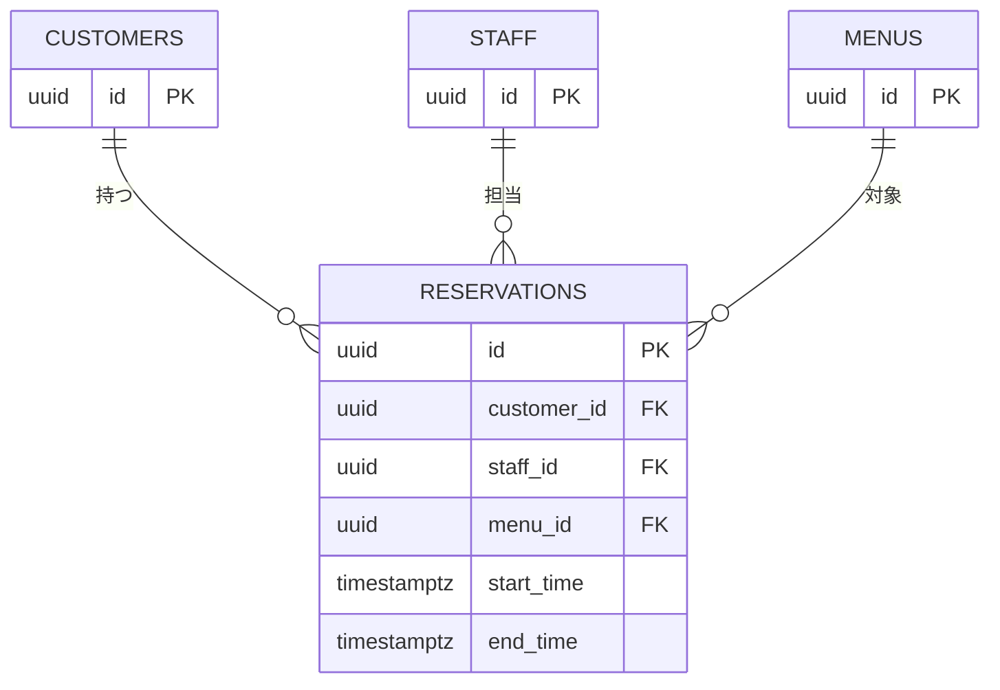

## はじめに

Web エンジニアを目指して学習中です。「予約システムを作れるようになりたい」と思い、個人サロンの予約システムを題材に設計から取り組んでいます。

この記事では、要件定義 → ER図 → DB設計 までを、自分がどう考えたかを含めてまとめます。同じように「予約システムを作ってみたいけど、どう設計すればいいの?」という方の参考になれば嬉しいです。

## 1. どんな課題を解くのか

まず「誰の、何の課題を解くのか」から考えました。

個人サロンのオーナーは、施術中に電話に出られず、予約を取りこぼしてしまう。この課題に対して、こういうものを作ります：

- お客さんが 24時間ネットで予約できる
- 予約の重複（ダブルブッキング）が起きない
- オーナーが予約を一覧で管理できる

## 2. 要件を整理する（MoSCoW）

いきなり全機能を作るのではなく、優先度で仕分けます。MoSCoW という考え方を使いました。

- **Must（必須）**：サービスと日時を選んで予約 / 重複予約の防止 / 予約一覧 / 完了メール
- **Want（あると良い）**：予約のキャンセル・変更 / ログイン / スタッフ複数対応
- **Won't（今回やらない）**：決済 / ポイント機能

「やらないこと（Won't）」を最初に決めておくのが大事だと学びました。スコープが無限に膨らむのを防げるからです。

## 3. 登場する"もの"を洗い出す（ER図）

予約システムに登場する"もの"を洗い出すと、4つになりました。

- **customers**（お客さん）
- **staff**（スタッフ）
- **menus**（メニュー）
- **reservations**（予約）

ここでポイントなのが、メニューを予約の中に直接書かず、**別のテーブルに分ける**ことです。理由は「同じ情報を何度もコピーしない」ため。たとえばカラーの所要時間を後で変更したいとき、メニューを別テーブルにしておけば1箇所直すだけで済みます（正規化という考え方）。



`reservations` が中心にいて、他の3つを「指さしている（FK＝外部キー）」形です。

## 4. DBを設計する（型と制約）

ER図をテーブルに落とし込みます。各カラムに「型」と「制約」を付けます。

```
reservations
- id           uuid        PK
- customer_id  uuid        NOT NULL  FK→customers
- staff_id     uuid        NOT NULL  FK→staff
- menu_id      uuid        NOT NULL  FK→menus
- start_time   timestamptz NOT NULL
- end_time     timestamptz NOT NULL
```

- **PK（主キー）**：その行を特定する背番号
- **NOT NULL**：空っぽを禁止（名前のない予約を作れない）
- **FK（外部キー）**：他テーブルに実在するidしか入れられない

制約は「おかしいデータをDBが物理的に拒否する」仕組みで、人間やアプリのミスを止める最後の砦になります。

ちなみに、予約が `start_time` と `end_time` の両方を持つ理由は、次の重複判定に「時間の幅」が必要だからです。

## 5. 一番の肝：ダブルブッキング防止

このシステムで一番むずかしいのが重複予約の防止です。条件はこうです。

> **同じスタッフ ＆ 時間帯が重なる** → NG

スタッフが違えば同じ時間でもOK（2人並行で施術できる）。同じスタッフでも時間が重ならなければOK。この2つが両方そろったときだけダブルブッキングです。

これを防ぐには、アプリ側のチェックだけだと「同時に2人が予約した瞬間」にすり抜けてしまいます。そこで PostgreSQL の **EXCLUSION制約** を使い、DB自身に「重なり禁止」を刻みます。

```sql
ALTER TABLE reservations
  ADD CONSTRAINT no_double_booking
  EXCLUDE USING gist (
    staff_id WITH =,
    tstzrange(start_time, end_time) WITH &&
  );
```

`staff_id WITH =`（同じスタッフ）と `&&`（時間帯が重なる）で、まさに条件そのものがDBのルールになっています。

**安全はDBの制約に、親切はアプリのチェックに** ——この二段構えが大事だと学びました。

## おわりに

要件定義からDB設計まで、自分がどう考えたかをまとめました。設計を先に固めておくと、実装のときに迷いが減ると実感しています。

次はAPI設計に進む予定です。最後まで読んでいただきありがとうございました。
